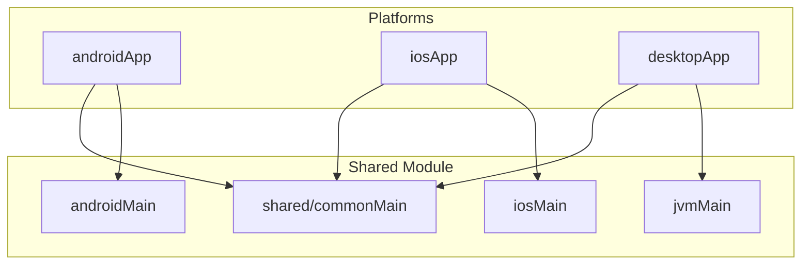

# Kotlin Multiplatform Template

[](https://github.com/nkrebs13/kmp-template/actions/workflows/ci.yml)
[](https://kotlinlang.org)
[](https://www.jetbrains.com/lp/compose-multiplatform/)
[](LICENSE)

A production-ready Kotlin Multiplatform template for iOS, Android and desktop (JVM) apps with Compose Multiplatform.

## Quick Start

Click **Use this template** on GitHub: a workflow runs `setup.sh` on the new repository's first
commit, deriving the name and package from it (`io.github.<owner>.<repo>`). Or clone and run it:

```bash
git clone https://github.com/nkrebs13/kmp-template.git my-app
cd my-app
./setup.sh --name WeatherApp --package com.acme.weather --yes
```

Useful flags: `--bundle-id`, `--display-name`, `--author` (LICENSE holder), `--no-desktop`,
`--dry-run` (list every change, change nothing) and `--json` (one machine-readable result).
Without a terminal, `setup.sh` never prompts: a missing value exits with code 2. See
`./setup.sh --help` for every flag and exit code.

## Requirements

| Tool | Version | Notes |
|------|---------|-------|
| JDK | 21 | Gradle toolchain; auto-provisioned via foojay if missing |
| Android Studio | Latest | With KMP plugin |
| Xcode | 16.0+ | macOS only, for iOS builds |
| macOS | 14.0+ (Sonoma) | Required for iOS development |

### iOS Development Requirements

iOS builds require macOS with Xcode. The template targets:
- iOS 16.0+ deployment target
- Xcode 16.0+ (the project uses synchronized folders)
- Apple Silicon Mac for simulator builds (the Intel `iosX64` target is not declared)

## Architecture



## Project Structure

```
kmp-template/
├── androidApp/          # Android application module
├── iosApp/              # iOS Xcode project
├── desktopApp/          # Desktop (JVM) application module
├── shared/              # KMP shared code
│   ├── commonMain/      # Cross-platform code
│   ├── androidMain/     # Android-specific implementations
│   ├── iosMain/         # iOS-specific implementations
│   └── jvmMain/         # Desktop (JVM) implementations
├── baselineprofile/     # Android performance optimization
├── build-logic/         # Convention plugins that hold all shared build configuration
├── config/              # detekt rules, Compose stability configuration
├── gradle/              # Build configuration & version catalog
├── .template/           # Generator data: tokens, template-only paths, leftover checks, project docs
├── tests/setup/         # setup.sh tests
├── scripts/             # Release script
├── docs/                # Documentation
└── setup.sh             # Template generation script
```

## Included Dependencies

| Category | Library | Version |
|----------|---------|---------|
| **Language** | Kotlin | 2.4.21 |
| **UI** | Compose Multiplatform | 1.12.2 |
| **Build** | Android Gradle Plugin | 9.5.0 |
| **Build** | Gradle | 9.6.1 |
| **Async** | Kotlinx Coroutines | 1.11.0 |
| **Code Quality** | Detekt | 1.23.8 |
| **Code Quality** | Spotless | 8.10.4 |
| **Coverage** | Kover | 0.9.11 |

This template includes only essential dependencies to keep your project lean. The version catalog also includes entries for commonly-needed libraries that are not wired into module builds by default — add them to your module `dependencies {}` as needed. These optional entries (Kotlinx Serialization, Compose Navigation, Kotlinx DateTime, Room, Ktor, Koin and more) sit in clearly marked blocks in [libs.versions.toml](gradle/libs.versions.toml).

## Build Commands

```bash
# Android
./gradlew :androidApp:assembleDebug
./gradlew :androidApp:assembleRelease

# Desktop
./gradlew :desktopApp:run
./gradlew :desktopApp:hotRun --auto   # Compose Hot Reload
./gradlew :desktopApp:packageDistributionForCurrentOS

# iOS Framework
./gradlew :shared:linkDebugFrameworkIosSimulatorArm64
./gradlew :shared:linkReleaseFrameworkIosArm64

# Testing
./gradlew :shared:allTests

# Code Quality
./gradlew spotlessApply    # Format code
./gradlew detekt           # Static analysis
./gradlew :shared:koverVerify  # Verify code coverage (60% minimum)

# Generator tests (for template development)
bash tests/setup/run.sh
```

## Troubleshooting

### Android Build Fails

1. **Missing SDK**: Create `local.properties` with `sdk.dir=/path/to/android/sdk`
2. **JDK**: Ensure a JDK is on `PATH` or in `JAVA_HOME`; Gradle downloads the JDK 21 toolchain it needs
3. **Gradle Issues**: Try `./gradlew clean` then rebuild

### iOS Build Fails

1. **Xcode Not Found**: Install Xcode from the App Store
2. **Framework Missing**: Run `./gradlew :shared:linkDebugFrameworkIosSimulatorArm64`
3. **Signing Issues**: Copy `iosApp/Configuration/Local.xcconfig.example` to `Local.xcconfig` (gitignored) and set `TEAM_ID`

### setup.sh Fails

`setup.sh` checks its own result before it starts the new git history. If template references
remain, it lists each `file:line`, exits with code 5 and prints the commands that restore the
template. Please report it as a bug.

## Contributing

Contributions are welcome! Please read our [Contributing Guide](CONTRIBUTING.md) and [Code of Conduct](CODE_OF_CONDUCT.md) before submitting a PR.

## License

This project is licensed under the MIT License - see the [LICENSE](LICENSE) file for details.
